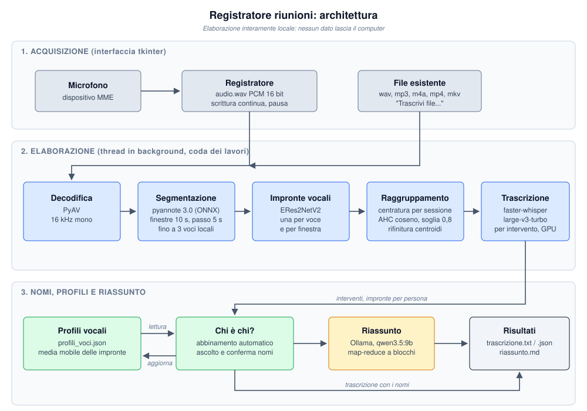

# Registratore riunioni

Applicazione desktop per Windows che registra le riunioni, ne produce la trascrizione in italiano, attribuisce ogni intervento alla persona che lo ha pronunciato e redige un verbale sintetico.

L'intera elaborazione avviene sul computer dell'utente. Audio, trascrizioni, impronte vocali e riassunti non vengono mai inviati a servizi esterni.

## Indice

1. [Funzionalità](#funzionalità)
2. [Architettura](#architettura)
3. [Requisiti](#requisiti)
4. [Installazione](#installazione)
5. [Utilizzo](#utilizzo)
6. [File prodotti](#file-prodotti)
7. [Parametri di configurazione](#parametri-di-configurazione)
8. [Validazione e prestazioni](#validazione-e-prestazioni)
9. [Struttura del progetto](#struttura-del-progetto)
10. [Riservatezza dei dati](#riservatezza-dei-dati)
11. [Limiti noti](#limiti-noti)
12. [Componenti di terze parti](#componenti-di-terze-parti)

## Funzionalità

* **Registrazione** dal microfono con pausa e ripresa. L'audio viene scritto su disco in modo continuo, perciò resta utilizzabile anche in caso di interruzione improvvisa.
* **Trascrizione di file esistenti** in formato audio o video (wav, mp3, m4a, ogg, flac, mp4, mkv, webm e altri).
* **Riconoscimento dei parlatori** (diarizzazione): il sistema individua quante persone hanno parlato e a chi appartiene ciascun intervento, anche senza conoscerne il numero in anticipo.
* **Trascrizione per intervento** con Whisper large-v3-turbo, accelerata dalla GPU NVIDIA quando disponibile.
* **Profili vocali persistenti**: dopo aver assegnato un nome a una voce, la stessa persona viene riconosciuta automaticamente nelle riunioni successive.
* **Verbale automatico** generato da un modello linguistico locale tramite Ollama, con sintesi, argomenti discussi, decisioni, azioni da svolgere e questioni aperte.

## Architettura



Il flusso di elaborazione è articolato in tre fasi.

### 1. Acquisizione

L'interfaccia grafica, realizzata con tkinter, registra il microfono selezionato in un file `audio.wav` (PCM 16 bit, mono). In alternativa l'utente può indicare un file già esistente. Ogni lavoro viene inserito in una coda ed elaborato da un thread dedicato, così l'interfaccia resta reattiva e consente di avviare una nuova registrazione mentre la precedente è in elaborazione.

### 2. Elaborazione

| Passo | Componente | Descrizione |
|---|---|---|
| Decodifica | PyAV | Conversione dell'audio a 16 kHz mono. |
| Segmentazione | pyannote segmentation 3.0 (ONNX) | L'audio viene analizzato in finestre di 10 secondi con passo di 5 secondi. In ogni finestra il modello separa fino a tre voci locali e individua le sovrapposizioni. |
| Impronte vocali | ERes2NetV2 (3D-Speaker) | Per ogni voce locale di ogni finestra viene calcolata un'impronta vocale usando tutto il parlato esclusivo di quella voce nella finestra. |
| Raggruppamento | `diarizzazione.py` | Le impronte vengono centrate rispetto alla media della sessione, per eliminare le caratteristiche comuni dovute a stanza e microfono, e raggruppate con clustering gerarchico (distanza coseno). Una rifinitura iterativa riassegna ogni impronta al centroide più vicino ed elimina i gruppi con meno di 8 secondi di parlato, che sono quasi sempre frammenti di un'altra voce. |
| Trascrizione | faster-whisper large-v3-turbo | Ogni intervento viene trascritto separatamente. Questa scelta evita che Whisper salti interi passaggi in corrispondenza dei cambi di voce e filtra le frasi spurie tipiche dei silenzi. |

### 3. Nomi, profili e riassunto

Al termine dell'elaborazione le impronte medie di ciascuna persona vengono confrontate con i profili salvati in `profili_voci.json`. L'abbinamento è univoco: ogni nome viene assegnato al massimo a una voce, a partire dalle coppie più simili. Nella finestra "Chi è chi?" l'utente ascolta un campione di ogni voce, conferma o corregge i nomi proposti e può unire due voci assegnando loro lo stesso nome. Al salvataggio i profili vengono aggiornati con una media mobile, così migliorano a ogni riunione.

Il riassunto viene quindi generato dal modello `qwen3.5:9b` eseguito da Ollama. Le trascrizioni lunghe vengono suddivise in blocchi: da ciascun blocco si estraggono appunti strutturati, che vengono poi fusi nel verbale finale. Prima del riassunto il modello Whisper viene rimosso dalla memoria della GPU per lasciare spazio al modello linguistico.

## Requisiti

| Componente | Requisito |
|---|---|
| Sistema operativo | Windows 10 o 11 |
| Python | 3.14 (versione con cui il progetto è sviluppato e verificato) |
| GPU | Facoltativa. Consigliata una scheda NVIDIA con almeno 6 GB di memoria. Senza GPU la trascrizione usa la CPU ed è più lenta. |
| Spazio su disco | Circa 2 GB per i modelli, più lo spazio per le registrazioni (circa 330 MB per ora di audio a 48 kHz). |
| Ollama | Facoltativo, necessario solo per il riassunto. Il modello predefinito `qwen3.5:9b` richiede circa 6,5 GB. |

## Installazione

1. Clonare il repository e creare l'ambiente virtuale:

   ```powershell
   git clone https://github.com/SinghProbjot/registratore-riunioni.git
   cd registratore-riunioni
   python -m venv .venv
   .venv\Scripts\python -m pip install -r requirements.txt
   ```

2. Scaricare i modelli per il riconoscimento delle voci:

   ```powershell
   .venv\Scripts\python scarica_modelli.py
   ```

   Il modello Whisper (circa 1,6 GB) viene scaricato automaticamente alla prima trascrizione.

3. Per il riassunto, installare [Ollama](https://ollama.com) e scaricare il modello:

   ```powershell
   ollama pull qwen3.5:9b
   ```

La versione di PyAV deve restare inferiore alla 16, poiché le versioni successive non sono compatibili con faster-whisper 1.2.1. Il vincolo è già indicato in `requirements.txt`.

## Utilizzo

### Interfaccia grafica

Avviare `Avvia registratore.bat` con un doppio clic.

1. Inserire il titolo della riunione (facoltativo), scegliere il microfono e, se noto, il numero di partecipanti. Con l'opzione "Automatico" il numero viene stimato dal sistema.
2. Premere **Registra** oppure il tasto F9. Durante la registrazione sono disponibili la pausa e l'indicatore di livello.
3. Premere **Stop**. La registrazione viene messa in coda per l'elaborazione.
4. Al termine si apre la finestra **Chi è chi?**. Le voci già note sono indicate come riconosciute. Per le altre è possibile ascoltare un campione e scrivere il nome.
5. Con **Salva e apri** i nomi vengono applicati alla trascrizione e memorizzati nei profili. Se la relativa opzione è attiva, parte poi la generazione del riassunto.

Funzioni aggiuntive:

| Pulsante | Funzione |
|---|---|
| Trascrivi file... | Elabora un file audio o video già esistente. |
| Rinomina voci... | Riapre la finestra dei nomi per una riunione già elaborata. |
| Riassunto... | Genera il riassunto per una riunione già trascritta. |
| Apri cartella | Apre la cartella delle registrazioni. |

### Riga di comando

```powershell
# Trascrizione di un file (il numero di persone è facoltativo)
.venv\Scripts\python registratore.py riunione.mp3 4

# Riassunto di una riunione già trascritta
.venv\Scripts\python riassunto.py registrazioni\2026-11-20_10-00_Produzione
```

## File prodotti

Ogni riunione viene salvata in una cartella dedicata `registrazioni/<data>_<ora>_<titolo>/`:

| File | Contenuto |
|---|---|
| `audio.wav` | Registrazione originale (assente se si è trascritto un file esterno). |
| `trascrizione.txt` | Trascrizione leggibile con orari e nomi dei partecipanti. |
| `trascrizione.json` | Dati strutturati: interventi, nomi, impronte vocali per persona, voci riconosciute, tempi di elaborazione. |
| `riassunto.md` | Verbale in formato Markdown. |
| `errore.txt` | Presente solo in caso di errore, con il dettaglio tecnico. |

Il verbale contiene sempre le seguenti sezioni: Sintesi, Argomenti discussi, Decisioni, Azioni da fare (tabella con responsabile, attività e scadenza) e Questioni aperte.

## Parametri di configurazione

I parametri principali sono definiti all'inizio delle sezioni corrispondenti dei moduli.

| Parametro | File | Valore | Significato |
|---|---|---|---|
| `EMB_MODEL` | `registratore.py` | ERes2NetV2 | Modello per le impronte vocali, da collocare in `models/emb/`. |
| `DIAR_THRESHOLD` | `registratore.py` | 0,8 | Distanza coseno massima tra impronte della stessa persona. Valori più bassi separano più voci. |
| `MIN_SPEAKER_SPEECH` | `registratore.py` | 8 s | Parlato minimo perché un gruppo sia considerato una persona distinta. |
| `PROFILE_MIN_SIM` | `registratore.py` | 0,78 | Somiglianza minima per riconoscere una voce salvata. |
| `MODEL` | `riassunto.py` | `qwen3.5:9b` | Modello Ollama usato per il riassunto. |
| `CHUNK_CHARS` | `riassunto.py` | 14.000 | Dimensione dei blocchi di trascrizione nel riassunto delle riunioni lunghe. |

I profili sono legati al modello di impronte con cui sono stati creati: se si cambia `EMB_MODEL`, i profili esistenti vengono ignorati e le voci vanno nominate di nuovo.

## Validazione e prestazioni

I parametri sono stati scelti su un banco di prova di riunioni simulate da 3 a 6 partecipanti, costruite con registrazioni di parlato italiano a cui sono stati aggiunti riverbero ambientale, rumore di fondo e volumi diversi tra i partecipanti. La metrica è il Diarization Error Rate (DER), cioè la quota di parlato attribuita alla persona sbagliata.

| Configurazione | DER, numero di persone automatico | DER, numero di persone indicato |
|---|---|---|
| Diarizzazione sherpa-onnx standard (versione iniziale) | 60% | da 37 a 46% |
| Nuovo modulo con modello ResNet34 | da 31 a 34% | 30% |
| Nuovo modulo con modello ERes2NetV2 (attuale) | da 17 a 18% | 16% |

Riconoscimento dei profili tra riunioni diverse, con soglia 0,78: circa il 96% delle persone già salvate viene riconosciuto, con meno dell'1% di scambi tra persone diverse.

Tempi indicativi su un portatile con GPU NVIDIA RTX 4050 da 6 GB:

| Fase | Tempo per un'ora di riunione |
|---|---|
| Riconoscimento delle voci (CPU) | circa 4 minuti |
| Trascrizione (GPU) | circa 5 minuti |
| Riassunto (Ollama) | alcuni minuti, in funzione della lunghezza |

Il banco di prova simula condizioni acustiche difficili. In riunioni reali i risultati dipendono soprattutto dalla posizione del microfono rispetto ai partecipanti.

## Struttura del progetto

```
registratore-riunioni/
├── registratore.py          Interfaccia grafica, registrazione, pipeline di elaborazione, profili
├── diarizzazione.py         Segmentazione, impronte vocali, raggruppamento, abbinamento profili
├── riassunto.py             Generazione del verbale tramite Ollama
├── scarica_modelli.py       Download dei modelli di segmentazione e impronte vocali
├── Avvia registratore.bat   Avvio rapido dell'interfaccia
├── requirements.txt         Dipendenze Python
├── docs/
│   └── architettura.svg     Schema dell'architettura
├── models/                  Modelli scaricati (esclusi dal repository)
└── registrazioni/           Riunioni elaborate (escluse dal repository)
```

## Riservatezza dei dati

* Tutti i modelli vengono eseguiti in locale. La sola connessione di rete avviene al primo avvio, per scaricare i modelli.
* Ollama viene interrogato all'indirizzo locale `localhost:11434`.
* Il file `profili_voci.json` contiene impronte vocali, che costituiscono dati biometrici ai sensi del GDPR. È consigliabile informare i partecipanti e conservarlo con le stesse cautele riservate alle registrazioni.
* Le cartelle `registrazioni/` e `models/` e il file `profili_voci.json` sono esclusi dal controllo di versione tramite `.gitignore`.

## Limiti noti

* Il parlato sovrapposto viene attribuito a una sola persona.
* Interventi molto brevi (sotto il secondo) possono essere assegnati alla persona che parla subito prima o subito dopo.
* Il riassunto è generato automaticamente e va verificato con la trascrizione prima della diffusione.
* La registrazione acquisisce un solo microfono, in mono. Per le riunioni ibride i partecipanti remoti vengono registrati solo se il loro audio è riprodotto dagli altoparlanti della sala.

## Componenti di terze parti

| Componente | Utilizzo | Licenza |
|---|---|---|
| [faster-whisper](https://github.com/SYSTRAN/faster-whisper) e modello Whisper large-v3-turbo | Trascrizione | MIT |
| [sherpa-onnx](https://github.com/k2-fsa/sherpa-onnx) | Estrazione delle impronte vocali | Apache 2.0 |
| [pyannote segmentation 3.0](https://huggingface.co/pyannote/segmentation-3.0) | Segmentazione dei parlatori | MIT |
| [3D-Speaker ERes2NetV2](https://github.com/modelscope/3D-Speaker) | Impronte vocali | Apache 2.0 |
| [Ollama](https://ollama.com) e modello Qwen | Riassunto | Si rimanda alle rispettive licenze |
