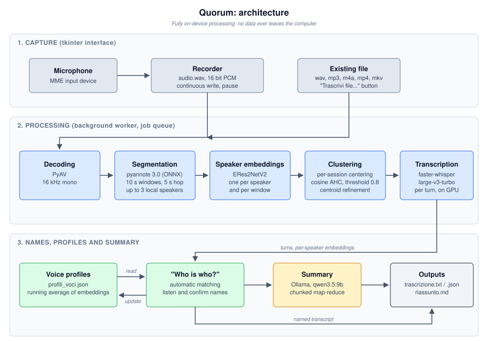

# Quorum

Quorum is a Windows desktop application that records meetings, transcribes them, attributes every turn to the person who spoke it and drafts concise meeting minutes.

All processing runs on the user's own computer. Audio, transcripts, voice embeddings and summaries are never sent to external services.

The user interface and the generated documents are in Italian, and transcription is tuned for Italian speech.

## Contents

1. [Features](#features)
2. [Architecture](#architecture)
3. [Requirements](#requirements)
4. [Installation](#installation)
5. [Usage](#usage)
6. [Output files](#output-files)
7. [Configuration](#configuration)
8. [Evaluation and performance](#evaluation-and-performance)
9. [Project structure](#project-structure)
10. [Privacy](#privacy)
11. [Known limitations](#known-limitations)
12. [Third party components](#third-party-components)

## Features

* **Recording** from any microphone, with pause and resume. Audio is written to disk continuously, so the recording remains usable even after an unexpected shutdown.
* **Transcription of existing files** in audio or video formats (wav, mp3, m4a, ogg, flac, mp4, mkv, webm and more).
* **Speaker diarization**: the system determines how many people spoke and who said what, even when the number of participants is not known in advance.
* **Per turn transcription** with Whisper large-v3-turbo, accelerated by an NVIDIA GPU when available.
* **Persistent voice profiles**: once a voice has been given a name, the same person is recognised automatically in later meetings.
* **Automatic minutes** produced by a local language model through Ollama, covering summary, topics, decisions, action items and open questions.

## Architecture



The processing pipeline is organised in three stages.

### 1. Capture

The tkinter interface records the selected microphone into an `audio.wav` file (16 bit PCM, mono). Alternatively, the user can select an existing file. Every job is placed in a queue and handled by a dedicated worker thread, so the interface stays responsive and a new recording can start while the previous one is still being processed.

### 2. Processing

| Step | Component | Description |
|---|---|---|
| Decoding | PyAV | Converts the audio to 16 kHz mono. |
| Segmentation | pyannote segmentation 3.0 (ONNX) | Audio is analysed in 10 second windows with a 5 second hop. Within each window the model separates up to three local speakers and detects overlapping speech. |
| Speaker embeddings | ERes2NetV2 (3D-Speaker) | One embedding is computed for every local speaker in every window, using all of that speaker's exclusive speech within the window. |
| Clustering | `diarizzazione.py` | Embeddings are centred on the session mean, which removes traits shared by everyone in the recording such as room acoustics and microphone colouring, and then grouped by agglomerative hierarchical clustering on cosine distance. An iterative refinement reassigns every embedding to its nearest centroid and drops clusters with less than 8 seconds of speech, which are almost always fragments of another voice. |
| Transcription | faster-whisper large-v3-turbo | Each turn is transcribed on its own. This prevents Whisper from skipping whole passages at speaker changes and filters out the spurious phrases typically hallucinated during silence. |

### 3. Names, profiles and summary

Once processing is complete, the average embedding of each speaker is compared with the profiles stored in `profili_voci.json`. Matching is one to one: each name is assigned to at most one voice, starting from the most similar pairs. In the "Chi è chi?" (who is who) dialog the user listens to a sample of every voice, confirms or corrects the suggested names, and can merge two voices by giving them the same name. On save, profiles are updated with a running average, so they improve with every meeting.

The summary is then generated by the `qwen3.5:9b` model served by Ollama. Long transcripts are split into chunks: structured notes are extracted from each chunk and then merged into the final minutes. Before summarisation the Whisper model is released from GPU memory to make room for the language model.

## Requirements

| Component | Requirement |
|---|---|
| Operating system | Windows 10 or 11 |
| Python | 3.14 (the version the project is developed and tested with) |
| GPU | Optional. An NVIDIA card with at least 6 GB of memory is recommended. Without a GPU, transcription runs on the CPU and is slower. |
| Disk space | About 2 GB for the models, plus storage for recordings (about 330 MB per hour of audio at 48 kHz). |
| Ollama | Optional, required only for summaries. The default `qwen3.5:9b` model needs about 6.5 GB. |

## Installation

1. Clone the repository and create a virtual environment:

   ```powershell
   git clone https://github.com/SinghProbjot/quorum.git
   cd quorum
   python -m venv .venv
   .venv\Scripts\python -m pip install -r requirements.txt
   ```

2. Download the speaker recognition models:

   ```powershell
   .venv\Scripts\python scarica_modelli.py
   ```

   The Whisper model (about 1.6 GB) is downloaded automatically on the first transcription.

3. For summaries, install [Ollama](https://ollama.com) and pull the model:

   ```powershell
   ollama pull qwen3.5:9b
   ```

PyAV must stay below version 16, because later releases are not compatible with faster-whisper 1.2.1. The constraint is already declared in `requirements.txt`.

## Usage

### Graphical interface

Double click `Avvia Quorum.bat`.

1. Optionally enter a meeting title, choose the microphone and, if known, the number of participants. With "Automatico" the number is estimated by the system.
2. Press **Registra** (record) or F9. A pause button and a level meter are available while recording.
3. Press **Stop**. The recording is queued for processing.
4. When processing ends, the **Chi è chi?** dialog opens. Known voices are marked as recognised. For the others you can play a sample and type a name.
5. **Salva e apri** (save and open) applies the names to the transcript and stores them in the voice profiles. If the corresponding option is enabled, summary generation starts next.

Additional buttons:

| Button | Function |
|---|---|
| Trascrivi file... | Processes an existing audio or video file. |
| Rinomina voci... | Reopens the naming dialog for a meeting that has already been processed. |
| Riassunto... | Generates the summary for a meeting that has already been transcribed. |
| Apri cartella | Opens the recordings folder. |

### Command line

```powershell
# Transcribe a file (the number of speakers is optional)
.venv\Scripts\python registratore.py meeting.mp3 4

# Summarise a meeting that has already been transcribed
.venv\Scripts\python riassunto.py registrazioni\2026-11-20_10-00_Produzione
```

## Output files

Each meeting is saved in its own folder, `registrazioni/<date>_<time>_<title>/`:

| File | Content |
|---|---|
| `audio.wav` | Original recording (absent when an external file was transcribed). |
| `trascrizione.txt` | Readable transcript with timestamps and participant names. |
| `trascrizione.json` | Structured data: turns, names, per speaker embeddings, recognised voices, processing times. |
| `riassunto.md` | Meeting minutes in Markdown. |
| `errore.txt` | Present only if an error occurred, with technical details. |

The minutes always contain the same sections: summary, topics discussed, decisions, action items (a table of owner, task and deadline) and open questions.

## Configuration

The main parameters are defined at the top of the relevant section of each module.

| Parameter | File | Value | Meaning |
|---|---|---|---|
| `EMB_MODEL` | `registratore.py` | ERes2NetV2 | Speaker embedding model, located in `models/emb/`. |
| `DIAR_THRESHOLD` | `registratore.py` | 0.8 | Maximum cosine distance between embeddings of the same person. Lower values split voices more aggressively. |
| `MIN_SPEAKER_SPEECH` | `registratore.py` | 8 s | Minimum amount of speech for a cluster to count as a separate person. |
| `PROFILE_MIN_SIM` | `registratore.py` | 0.78 | Minimum similarity to recognise a saved voice. |
| `MODEL` | `riassunto.py` | `qwen3.5:9b` | Ollama model used for summaries. |
| `CHUNK_CHARS` | `riassunto.py` | 14,000 | Chunk size used when summarising long transcripts. |

Profiles are tied to the embedding model that created them: if `EMB_MODEL` changes, existing profiles are ignored and voices need to be named again.

## Evaluation and performance

Parameters were selected on a benchmark of simulated meetings with 3 to 6 participants, built from Italian speech recordings with added room reverberation, background noise and different loudness for each participant. The metric is the Diarization Error Rate (DER), the share of speech attributed to the wrong person.

| Configuration | DER, automatic speaker count | DER, known speaker count |
|---|---|---|
| Standard sherpa-onnx diarization (initial version) | 60% | 37% to 46% |
| New pipeline with ResNet34 embeddings | 31% to 34% | 30% |
| New pipeline with ERes2NetV2 embeddings (current) | 17% to 18% | 16% |

Recognition of saved profiles across different meetings, at a threshold of 0.78: about 96% of known people are recognised, with fewer than 1% of mix ups between different people.

Indicative timings on a laptop with an NVIDIA RTX 4050 (6 GB):

| Stage | Time per hour of meeting |
|---|---|
| Speaker recognition (CPU) | about 4 minutes |
| Transcription (GPU) | about 5 minutes |
| Summary (Ollama) | a few minutes, depending on length |

The benchmark simulates difficult acoustic conditions. In real meetings, results depend mostly on where the microphone is placed relative to the participants.

## Project structure

```
quorum/
├── registratore.py          Interface, recording, processing pipeline, voice profiles
├── diarizzazione.py         Segmentation, speaker embeddings, clustering, profile matching
├── riassunto.py             Minutes generation through Ollama
├── scarica_modelli.py       Downloads the segmentation and embedding models
├── Avvia Quorum.bat         Quick launcher for the interface
├── requirements.txt         Python dependencies
├── docs/
│   └── architecture.svg     Architecture diagram
├── models/                  Downloaded models (not tracked)
└── registrazioni/           Processed meetings (not tracked)
```

## Privacy

* All models run locally. The only network access happens on first use, to download the models.
* Ollama is queried at the local address `localhost:11434`.
* `profili_voci.json` contains voice embeddings, which are biometric data under the GDPR. Participants should be informed, and the file should be protected with the same care as the recordings.
* The `registrazioni/` and `models/` folders and the `profili_voci.json` file are excluded from version control through `.gitignore`.

## Known limitations

* Overlapping speech is attributed to a single person.
* Very short turns (under one second) may be assigned to the person speaking just before or after.
* Summaries are generated automatically and should be checked against the transcript before being shared.
* Recording captures a single microphone, in mono. In hybrid meetings, remote participants are recorded only if their audio is played through the room speakers.

## Third party components

| Component | Purpose | License |
|---|---|---|
| [faster-whisper](https://github.com/SYSTRAN/faster-whisper) and the Whisper large-v3-turbo model | Transcription | MIT |
| [sherpa-onnx](https://github.com/k2-fsa/sherpa-onnx) | Speaker embedding inference | Apache 2.0 |
| [pyannote segmentation 3.0](https://huggingface.co/pyannote/segmentation-3.0) | Speaker segmentation | MIT |
| [3D-Speaker ERes2NetV2](https://github.com/modelscope/3D-Speaker) | Speaker embeddings | Apache 2.0 |
| [Ollama](https://ollama.com) and the Qwen model | Summarisation | See the respective licenses |
